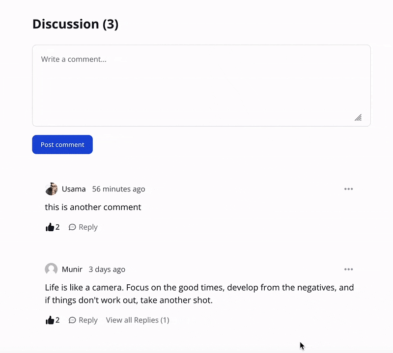

## Commentify - Laravel Livewire Comments

[](https://commentify.pro/?utm_source=github&utm_medium=readme&utm_campaign=commentify)

[](https://packagist.org/packages/usamamuneerchaudhary/commentify)
[](https://scrutinizer-ci.com/g/usamamuneerchaudhary/commentify/?branch=main)
[](https://www.codefactor.io/repository/github/usamamuneerchaudhary/commentify)
[](https://scrutinizer-ci.com/g/usamamuneerchaudhary/commentify/build-status/main)
[](https://scrutinizer-ci.com/code-intelligence)
[](https://packagist.org/packages/usamamuneerchaudhary/commentify)
[](https://packagist.org/packages/usamamuneerchaudhary/commentify)
[](https://github.com/usamamuneerchaudhary/commentify/blob/HEAD/LICENSE.md)
[](CHANGELOG.md)



Commentify is a Laravel Livewire comments package for any Eloquent model. Tailwind CSS and Bootstrap 5, nested replies, markdown, likes, reports, guest posting, and an optional Filament admin. PHP 8.3+, Laravel 12 or 13, Livewire 4.

The guides live at [docs.commentify.pro](https://docs.commentify.pro). This repository is the MIT package. [Commentify Pro](https://docs.commentify.pro/quickstart) adds the JSON API, React and Vue, and the moderation tools on the same tables.

## Install

Install from the [installation guide](https://docs.commentify.pro/installation).

```bash
composer require usamamuneerchaudhary/commentify
```

## Docs

- [Install](https://docs.commentify.pro/installation)
- [Usage](https://docs.commentify.pro/usage)
- [Threads](https://docs.commentify.pro/threads): sorting, reports, approval, markdown, lazy loading, thread loader
- [Configuration](https://docs.commentify.pro/configuration)
- [Guests](https://docs.commentify.pro/guests)
- [Customization](https://docs.commentify.pro/customization)
- [Notifications](https://docs.commentify.pro/notifications)
- [Filament](https://docs.commentify.pro/filament)
- [Authorization](https://docs.commentify.pro/authorization)
- [Upgrade](https://docs.commentify.pro/upgrading-core)

## Tests

```bash
composer test
```

## Security

Email hello@usamamuneer.me. See [SECURITY.md](SECURITY.md).

## License

The MIT License. See [LICENSE.md](LICENSE.md).
